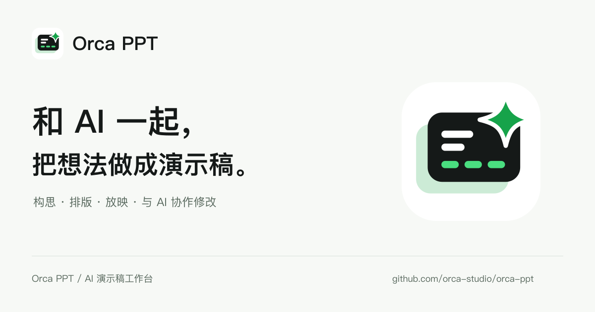

# Orca PPT

**和 AI 一起，把想法做成演示稿。**

[官网](https://ppt.orca-studio.ai) · [联系我们](#联系我们)

## 开始使用

Orca PPT 自己不带 AI，由你已经在用的 AI 助手来安装和使用它。WorkBuddy、Codex、Claude Code 都试过。

1. **让 AI 助手装好。** 把下面这句话发给它：

   ```
   读 https://ppt.orca-studio.ai/llms.txt ，帮我装好 Orca PPT。
   ```

   它会装一个 npm 包：Orca PPT 的 skill（设计规范和脚本，AI 助手照着它做稿子）、`orca-ppt` 命令和
   浏览器里的工作台。要用的 Node.js、Chrome 它会自己检查、装上，装好就在浏览器里打开工作台。
   macOS、Windows、Linux 都能用，不用配 MCP。

2. **做第一份稿子。** 在工作台首页挑一个同款，点「做同款」，把复制的那段话贴给 AI 助手，补上你的内容；
   或者直接跟它说要做什么稿子。工作台的标签页留在前台，在后台浏览器会让它变慢。

### 安装、接入遇到问题？

在 [GitHub Issues](https://github.com/orca-studio/orca-ppt/issues) 里提。

## 它能做什么



Orca PPT 让你用自己的 AI 助手做出**会动的演示稿**（在浏览器里用）：
翻页时，标题会滑到新的位置，卡片会展开成整页，数字会变成图表 —— 像发布会上那样连贯，
而不是一页一页地硬切。

你不用学排版，也不用调动画。告诉 AI 你要讲什么，它来做；哪里不满意，在画面上指给它看。

### 看到喜欢的效果，就「做同款」

打开工作台，首页就是一排同款，每张卡片是这个效果的封面。

喜欢哪个，点卡片右上角的「做同款」，把那段话复制给你的 AI 助手，再补上你自己的内容
（主题、每页要讲什么、名单……），它就会照着这个效果做出你的版本。

点卡片本身，可以打开样稿一页页翻着看：每两页之间是怎么衔接的，旁边都写着。

> 现在有二十多个同款：竞选自我介绍、发布会开场、团队介绍、年度回顾与规划、新品发布、季度数据报告……
> 每个都能在 [ppt.orca-studio.ai](https://ppt.orca-studio.ai) 上直接看它动起来。

### 自己给主题，从头做一份

不挑同款也行。直接跟你的 AI 助手说「帮我做一份介绍 Q3 增长的演示稿，给投资人看，五分钟」，
它会按 Orca PPT 内置的设计规范来做：配色、排版、每一页怎么接到下一页，都有讲究。
手里有表格（Excel、算格、CSV）就一起给它：页面上的每个数都会标明是从表格哪一格读出来的。

### 指给 AI 看，而不是描述给它听

稿子在工作台里实时放映。觉得哪里不对，直接在画面上点那个位置，写一句「这儿太挤了」，
AI 拿到的就是那个确切的位置，不用你费劲形容「第三页右边那个标题」。

文字要改，双击就能改；改错了可以撤销。

### 做完直接放映

成品是你电脑上的一个普通文件夹，用浏览器打开就能放映，方向键翻页。

## 常见问题

**需要会写代码吗？**
不需要。你只要会跟 AI 助手说话。连接 AI 助手也是发一句话给它，让它自己配置，只做一次。

**能导出成 PowerPoint 吗？**
工作台做出来的是网页形式的演示稿，动效最完整，用浏览器就能放映。官网上的同款可以直接下载 PPTX 模板；
把自己做的稿子导出成 PPTX，以后作为增值服务提供。

**要付费吗？**
Orca PPT 是开源的，MIT 许可，免费使用。

**稿子存在哪里？会上传吗？**
存在你电脑上你选的文件夹里，就是普通的文件。Orca PPT 只在你自己的电脑上运行，不会上传你的稿子；
你交给 AI 助手的内容，按那个助手自己的方式处理。

**哪里能看到更多效果？**
[ppt.orca-studio.ai](https://ppt.orca-studio.ai) 是 Orca PPT 的官网：所有同款点开就能放映，
在浏览器里一页页翻。

**支持 Windows 和 Linux 吗？**
都支持。浏览器工作台在 macOS、Windows、Linux 上都能用。

## 联系我们

使用中遇到问题，可以在 [GitHub Issues](https://github.com/orca-studio/orca-ppt/issues) 里提。

## 给开发者

架构、MCP 工具、从源码运行、内置的设计规范（skill）都在 [开发者文档](./docs/DEVELOPMENT.md)。

## 许可

[MIT](LICENSE)
