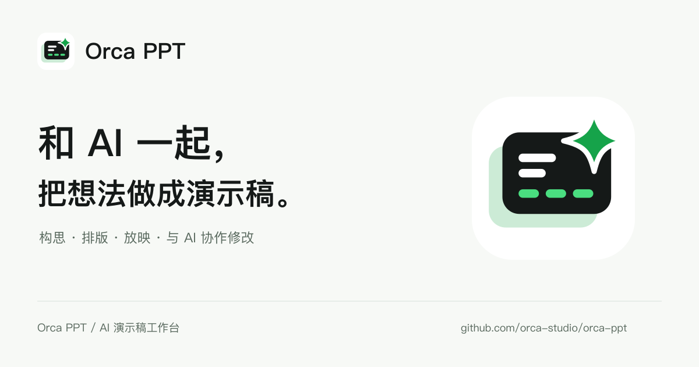

# Orca PPT

**和 AI 一起，把想法做成演示稿。**

[下载 Mac 版](https://github.com/orca-studio/orca-ppt/releases/latest/download/OrcaPPT-mac-arm64.dmg) · [官网](https://ppt.orca-studio.ai) · [关注更新](https://x.com/jevbot_dev) · [联系我们](#联系我们)



Orca PPT 是一个桌面应用，让你用自己的 AI 助手做出**会动的演示稿**：
翻页时，标题会滑到新的位置，卡片会展开成整页，数字会变成图表 —— 像发布会上那样连贯，
而不是一页一页地硬切。

你不用学排版，也不用调动画。告诉 AI 你要讲什么，它来做；哪里不满意，在画面上指给它看。

## 你可以用它做什么

### 看到喜欢的效果，就「做同款」

打开 Orca PPT，首页就是一排同款。鼠标停在卡片上，就能看到这个效果动起来的样子。

喜欢哪个，点卡片右上角的「做同款」，把那段话复制给你的 AI 助手，再补上你自己的内容
（主题、每页要讲什么、名单……），它就会照着这个效果做出你的版本。

点卡片本身，可以打开样稿一页页翻着看：每两页之间是怎么衔接的，旁边都写着。

> 现在有 14 个同款：手电筒开场、数字滚动时间轴、环形时间轴、一张表做成汇报稿、电影级回顾片尾、四栏产品切换……
> 每个都能在 [ppt.orca-studio.ai](https://ppt.orca-studio.ai) 上直接看它动起来。

### 自己给主题，从头做一份

不挑同款也行。直接跟你的 AI 助手说「帮我做一份介绍 Q3 增长的演示稿，给投资人看，五分钟」，
它会按 Orca PPT 内置的设计规范来做：配色、排版、每一页怎么接到下一页，都有讲究。
手里有表格（Excel、算格、CSV）就一起给它：页面上的每个数都会标明是从表格哪一格读出来的。

### 指给 AI 看，而不是描述给它听

稿子在 Orca PPT 里实时放映。觉得哪里不对，直接在画面上点那个位置，写一句「这儿太挤了」，
AI 拿到的就是那个确切的位置，不用你费劲形容「第三页右边那个标题」。

文字要改，双击就能改；改错了可以撤销。

### 做完直接放映

成品是你电脑上的一个普通文件夹，用浏览器打开就能放映，方向键翻页。
在 Orca PPT 里也可以全屏放映。

## 怎么开始

1. **准备一个 AI 助手。** Orca PPT 自己不带 AI，而是连接你已经在用的，支持 MCP 的都可以。
   还没有 AI 助手？可以试试 [Jevbot](https://jevbot.dev)。
2. **装上 Orca PPT。** 从 [ppt.orca-studio.ai](https://ppt.orca-studio.ai) 下载 Mac 版
   （macOS 12 以上，Apple Silicon），拖进「应用程序」打开。之后有新版本会自动更新。
3. **把 AI 助手连上 Orca PPT。** 应用开着的时候，把这个 MCP 地址加到你的 AI 助手里，只做一次：

   ```
   http://127.0.0.1:6722/mcp
   ```

   用命令行的助手一般一行就加好，比如：

   ```bash
   claude mcp add --transport http orca-ppt http://127.0.0.1:6722/mcp   # Claude Code
   codex mcp add orca-ppt --url http://127.0.0.1:6722/mcp               # Codex
   ```

   其他助手在各自的 MCP 设置里添加这个地址，名字填 `orca-ppt`。

4. **挑一个同款，点「做同款」**，把复制的那段话贴给 AI 助手，补上你的内容。

## 常见问题

**需要会写代码吗？**
不需要。你只要会跟 AI 助手说话。连接 AI 助手时要把一个地址加到它的设置里（命令行的助手是粘贴运行一行命令），只做一次。

**能导出成 PowerPoint 吗？**
还不能，正在做。成品本身是网页形式的演示稿，动效最完整。导出 PPTX 后，共享元素、形态变换这类连贯动效
靠 PowerPoint 的「平滑」保留；有些转场会退成淡入淡出，导出时会告诉你是哪几页。

**要付费吗？**
Orca PPT 是开源的，MIT 许可，免费使用。

**稿子存在哪里？会上传吗？**
存在你电脑上你选的文件夹里，就是普通的文件。Orca PPT 只在你自己的电脑上运行，不会上传你的稿子；
你交给 AI 助手的内容，按那个助手自己的方式处理。

**哪里能看到更多效果？**
[ppt.orca-studio.ai](https://ppt.orca-studio.ai) 是 Orca PPT 的官网：所有同款都能看样片，
点开就能在浏览器里一页页翻，也是下载安装包的地方。

**支持 Windows 吗？**
支持。Windows 安装包还在准备，现在可以先[从源码运行](./docs/DEVELOPMENT.md#从源码运行)。

## 联系我们

<table>
  <tr>
    <td align="center" valign="top" width="33%">
      <a href="https://x.com/jevbot_dev"></a>
      <p><a href="https://x.com/jevbot_dev"><strong>@jevbot_dev ↗</strong></a></p>
      <p><sub>产品动态</sub></p>
    </td>
    <td align="center" valign="top" width="33%">
      <a href="docs/contact/wechat-qrcode.png"></a>
      <p><strong>加微信</strong></p>
      <p><sub>扫码添加 · 点开放大</sub></p>
    </td>
    <td align="center" valign="top" width="33%">
      <a href="docs/contact/wechat-group-qrcode.png"></a>
      <p><strong>加入交流群</strong></p>
      <p><sub>微信或企业微信扫码<br>2026 年 10 月 15 日前有效</sub></p>
    </td>
  </tr>
</table>

使用中遇到问题，也可以在 [GitHub Issues](https://github.com/orca-studio/orca-ppt/issues) 里提。

## 给开发者

架构、MCP 工具、从源码运行、内置的设计规范（skill）都在 [开发者文档](./docs/DEVELOPMENT.md)。

## 许可

[MIT](LICENSE)
